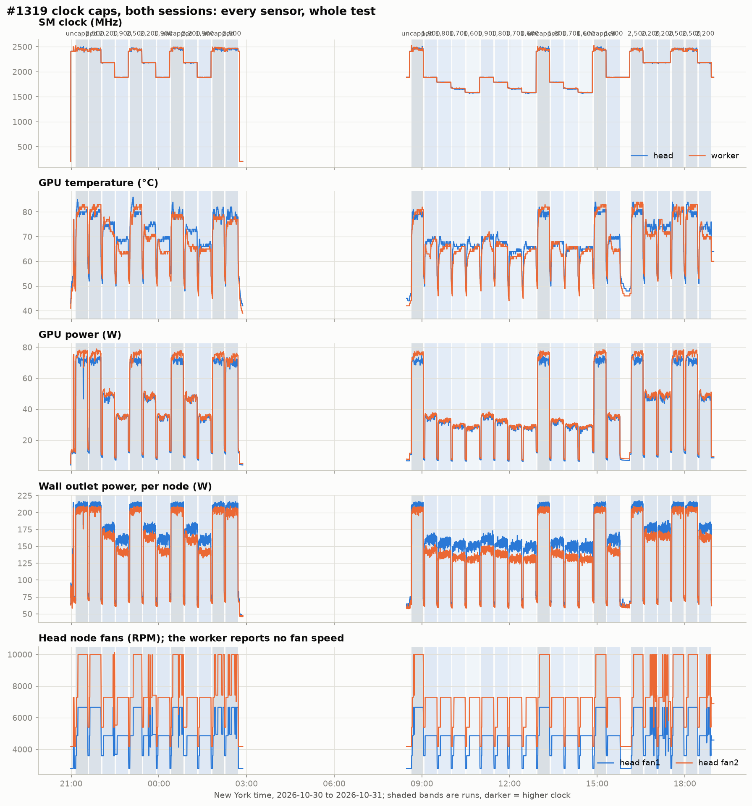
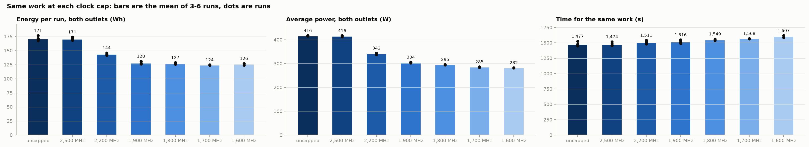
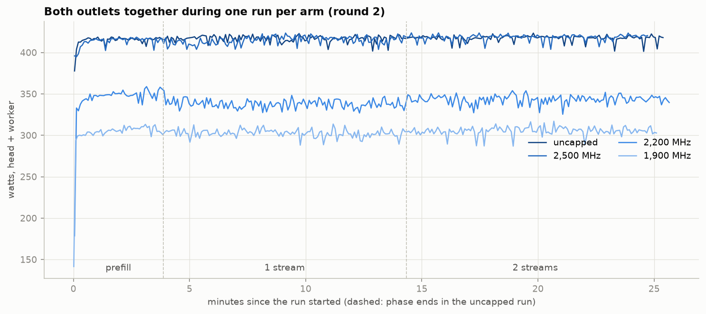
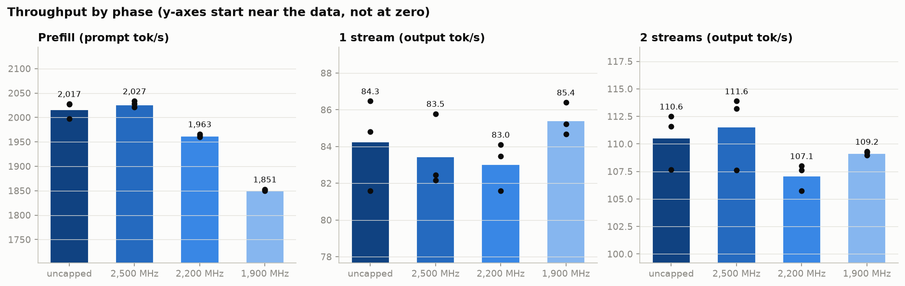
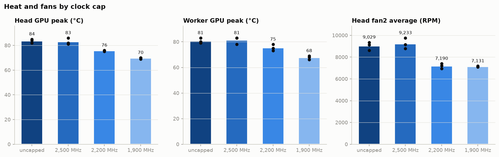

# GPU clock cap on the two-Spark cluster: report for #1319

Issue: https://github.com/evanwtf/local-llm/issues/1319 ·
result comment: https://github.com/evanwtf/local-llm/issues/1319#issuecomment-6540224622

**Question.** What does a GPU graphics-clock cap (`nvidia-smi -lgc 0,<MHz>`,
the setting MiaAI-Lab's sparkLimiter applies) cost in throughput, and what
does it save in power and heat, on the two-node DGX Spark cluster?

**Answer.** On this stack and this load, a 1,900 MHz cap did the same work in
1,507 s against 1,486 s uncapped (101.4% of the time). It used 126.9 Wh per
run against 171.9 Wh (73.9% of the energy), and the GPU peaks dropped from
84 / 81 °C to 70 / 68 °C (head / worker). Prefill is the only phase the cap
clearly slows: 1,851 against 2,017 prompt tok/s (91.8%). Single-stream
decode did not slow, and two-stream decode stayed inside the uncapped
arm's own run-to-run spread. A 2,500 MHz cap changes nothing, because the
GPUs already average about 2,460 MHz under this load.

Every number in this report comes from the files in [`data/`](data/). The
section [Evidence and how to check it](#evidence-and-how-to-check-it) says
which file holds what, and how to rebuild the tables and charts from them.

## Contents

- [What was tested](#what-was-tested)
- [How each sensor is read](#how-each-sensor-is-read)
- [Results by clock cap](#results-by-clock-cap)
- [The whole test, every sensor](#the-whole-test-every-sensor)
- [Power, energy and time](#power-energy-and-time)
- [Throughput](#throughput)
- [Heat and fans](#heat-and-fans)
- [Every run](#every-run)
- [What this does not show](#what-this-does-not-show)
- [Evidence and how to check it](#evidence-and-how-to-check-it)

## What was tested

| item | value |
|---|---|
| machine | the two-node DGX Spark cluster (2 × GB10), tensor parallel across both nodes (TP2) |
| stack | #1160: DeepSeek-V4.1-Flash-1017, EXL3 2.7 bpw (`0xSero/DeepSeek-V4.1-Flash-1017-EXL3-2.7bpw@e34ef55bda`) |
| server | `sudoingX/dgx-spark-deepseek-v41@cc59c36`, image `dsv41-serve:v4` (vLLM `6e517b15` + ExLlamaV3 1.6.0), launched with the recipe's `scripts/launch/dsv41_tp2.sh`, `reasoning_effort` low, 2 concurrent sequences (the recipe default) |
| NVIDIA driver | 580.178.04 on both nodes |
| driver script | [`scripts/clock_cap_ab.py`](../../scripts/clock_cap_ab.py) at `107597d2` |
| arms | uncapped (`sudo nvidia-smi -rgc`), and `sudo nvidia-smi -lgc 0,<MHz>` at 2,500, 2,200 and 1,900 MHz, set on both nodes |
| rounds | 3; the arm order rotates each round, so each arm takes each position and a drift in room temperature does not line up with one arm |
| test window | server ready 2026-10-30T21:03:33-0400; first run 2026-10-30T21:09:07-0400; last run ended 2026-10-31T02:42:23-0400; clocks reset on both nodes 2026-10-31T02:42:24-0400 |
| operator go | 2026-10-30T20:57-0400 |

**The same work in every run.** A run is three phases, back to back:

| phase | requests | at a time | each request |
|---|---|---|---|
| prefill | 20 | 1 | a ~23K-token prompt, 1 output token |
| 1 stream | 50 | 1 | 1,024 output tokens, end-of-sequence ignored |
| 2 streams | 70 | 2 | 1,024 output tokens, end-of-sequence ignored |

Requests go to `/v1/completions` at temperature 0 with a raw prompt, so the
chat template and the reasoning setting do not enter. Every prompt starts
with a nonce that names the run, so the prefix cache cannot serve one run's
prompt to another.

**Cool-down.** Before each run the driver set the arm's clock on both nodes,
waited at least 180 s, and then waited until both GPUs were at or below
their idle temperature + 3 °C (targets 57 / 58 °C). No cool-down hit its
900 s limit.

**Sensors.** GPU clock, temperature and power on each node come from DCGM
through Prometheus. The head node's two fans come from node_exporter through
the `nvfanread` driver; the worker reports no fan speed. Each node has its own
Kasa smart plug, read through Home Assistant. The inlet air is the indoor
sensor of a weather station in front of the cluster; it records only when its
value changes. [How each sensor is read](#how-each-sensor-is-read) has the
detail.

## How each sensor is read

| sensor | source | Prometheus or Influx series | resolution here |
|---|---|---|---|
| SM clock, GPU temperature, GPU power | NVIDIA DCGM exporter on each node | `DCGM_FI_DEV_SM_CLOCK`, `DCGM_FI_DEV_GPU_TEMP`, `DCGM_FI_DEV_POWER_USAGE` | 15 s |
| head fan speed | `nvfanread` driver, read by node_exporter's hwmon collector | `node_hwmon_fan_rpm{sensor="fan1"}`, `{sensor="fan2"}` | 15 s |
| wall power, each node | one TP-Link Kasa smart plug per node, through Home Assistant into InfluxDB | entities `dgx_current_consumption`, `dgx_2_current_consumption` (unit W) | about 5 s, 0.1 W |
| inlet air | weather-station indoor sensor, through Home Assistant into InfluxDB | entity `evan_s_pws_inside_temperature` (unit °F) | on change |

**Fan speed: `nvfanread`.** The DGX Spark exposes no fan speed to the
operating system; `sensors` shows only temperatures. The fan figures here
come from [`nvfanread`](https://github.com/evanwtf/dgx-spark-fan-override/tree/main/nvfanread),
a read-only kernel module in
[evanwtf/dgx-spark-fan-override](https://github.com/evanwtf/dgx-spark-fan-override)
(at `2b8d5c1313` when this report was written). It reads the embedded
controller's fan tachometer telemetry through the SoC's FF-A partition
(`arm-ffa-17`) and presents it as a standard hwmon device. node_exporter's
hwmon collector then emits `node_hwmon_fan_rpm` with no exporter
configuration. The module changes nothing on the fans; the same repo's
separate `nvfancontrol` module, which can override them, was not loaded:
the head ran only `nvfanread` from its boot on 2026-10-22 through the test,
and the two modules cannot be bound at the same time. The fans followed the
embedded controller's own automatic policy throughout. The module is built by DKMS and signed with a Machine
Owner Key, because Secure Boot rejects unsigned modules. The interface is
reverse-engineered and not an NVIDIA one; it was observed on EC firmware
`0x3000508`.

The worker node does not have the module yet
([evanwtf/dgx-spark-fan-override#14](https://github.com/evanwtf/dgx-spark-fan-override/issues/14)),
so this report has fan speed for the head node only.

**Wall power: Kasa smart plugs.** Each node is plugged into its own TP-Link
Kasa smart plug with energy monitoring. Home Assistant's TP-Link integration
reads each plug's present power draw and records it into InfluxDB, where
Grafana reads it (datasource `home_assistant/autogen`, measurement `W`). The
plugs are named "DGX 1" (the head) and "DGX 2" (the worker) in Home
Assistant.

- **What it measures:** the whole node at the wall: GPU, CPU, memory, NVMe,
  network, fans, and the power supply's own loss. That is why the outlet
  figures are higher than the GPU figures and fall less under a cap.
- **Cadence:** a reading about every 5 s from each plug. Across this test the
  largest gap between two readings was 15 s, on both plugs. The two plugs
  report on their own clocks, so their readings do not line up in time.
- **Resolution:** the recorded values carry 0.1 W.
- **Energy:** Home Assistant records power, not energy, so the energy per run
  in this report is the trapezoid integral of each plug's readings over the
  run, summed over both plugs
  ([`energy_wh`](../../scripts/clock_cap_evidence.py)).
- **Not checked here:** the plugs' accuracy against a calibrated meter. All
  arms are measured by the same two plugs, so a fixed calibration error
  scales every arm alike and does not change the shares.

## Results by clock cap

Each cell is the mean of 3 runs, then the range, then the share of the
uncapped mean. The table is generated from [`data/runs.csv`](data/runs.csv)
into [`data/tables.md`](data/tables.md).

| measure | uncapped | 2500 | 2200 | 1900 |
|---|---|---|---|---|
| run wall time (s) | 1,486 (1,463–1,526) | 1,486 (1,456–1,518), 100.0% | 1,523 (1,510–1,542), 102.4% | 1,507 (1,499–1,514), 101.4% |
| energy per run, both outlets (Wh) | 171.9 (169.0–176.6) | 171.2 (168.2–174.1), 99.6% | 144.2 (142.3–146.1), 83.9% | 126.9 (126.3–127.4), 73.9% |
| average power, both outlets (W) | 416 (415–417) | 415 (413–416), 99.7% | 341 (338–344), 81.9% | 303 (303–304), 72.9% |
| head outlet average (W) | 212 (211–212) | 211 (211–212), 99.8% | 177 (176–177), 83.5% | 160 (160–160), 75.8% |
| worker outlet average (W) | 204 (204–205) | 204 (202–205), 99.6% | 164 (161–167), 80.3% | 143 (142–143), 69.9% |
| head outlet peak (W) | 216 (216–217) | 216 (216–216), 99.9% | 186 (186–186), 85.8% | 170 (169–170), 78.3% |
| worker outlet peak (W) | 209 (209–210) | 209 (209–210), 100.0% | 175 (173–177), 83.4% | 150 (149–151), 71.7% |
| prefill (prompt tok/s) | 2,017 (1,997–2,028) | 2,027 (2,021–2,033), 100.5% | 1,963 (1,960–1,966), 97.3% | 1,851 (1,850–1,853), 91.8% |
| 1 stream (output tok/s) | 84.3 (81.6–86.5) | 83.5 (82.2–85.8), 99.0% | 83.0 (81.6–84.1), 98.5% | 85.4 (84.7–86.4), 101.4% |
| 2 streams (output tok/s) | 110.6 (107.7–112.5) | 111.6 (107.6–113.9), 100.9% | 107.1 (105.7–108.0), 96.9% | 109.2 (109.0–109.3), 98.7% |
| head SM clock average (MHz) | 2,457 (2,454–2,461) | 2,453 (2,450–2,456), 99.8% | 2,184 (2,183–2,184), 88.9% | 1,889 (1,889–1,889), 76.9% |
| worker SM clock average (MHz) | 2,465 (2,452–2,473) | 2,453 (2,447–2,464), 99.5% | 2,185 (2,184–2,186), 88.6% | 1,889 (1,889–1,890), 76.6% |
| head GPU peak (°C) | 84 (82–85) | 83 (81–86), 99.2% | 76 (75–76), 90.4% | 70 (69–70), 83.3% |
| worker GPU peak (°C) | 81 (79–83) | 81 (78–83), 100.8% | 75 (73–78), 93.4% | 68 (66–69), 83.9% |
| head GPU power average (W) | 70.5 (70.1–71.1) | 70.8 (70.3–71.5), 100.4% | 47.0 (46.5–47.5), 66.7% | 34.6 (34.0–35.0), 49.1% |
| worker GPU power average (W) | 74.5 (73.6–75.9) | 74.1 (72.6–74.9), 99.6% | 48.2 (46.7–49.7), 64.7% | 35.3 (35.0–35.5), 47.4% |
| head fan1 average (RPM) | 6,019 (5,743–6,235) | 6,156 (5,863–6,504), 102.3% | 4,793 (4,635–4,935), 79.6% | 4,754 (4,724–4,784), 79.0% |
| head fan2 average (RPM) | 9,029 (8,614–9,352) | 9,233 (8,795–9,756), 102.3% | 7,190 (6,953–7,403), 79.6% | 7,131 (7,085–7,177), 79.0% |
| inlet air at run end (°F) | 68.6 (65.8–70.3) | 66.5 (64.6–69.6), 97.0% | 68.0 (64.6–70.0), 99.2% | 68.4 (64.2–71.1), 99.8% |

What the table shows:

- **Energy follows the clock; time barely does.** At 1,900 MHz the cluster
  drew 113 W less at the wall (303 against 416 W) and finished the same work
  20 s later (1,507 against 1,486 s). The net is 45.0 Wh less per run.
- **The GPU itself is where the power goes.** GPU power fell from about
  70–75 W to about 35 W per node (49.1% and 47.4%). The outlets fell less
  (75.8% and 69.9%), because the rest of each node (CPU, memory, network,
  fans, the power supply's own loss) does not scale with the GPU clock.
- **2,200 MHz is the worse cap.** It saved less energy than 1,900 MHz
  (144.2 against 126.9 Wh) and was not faster: its two-stream mean
  (107.1 tok/s) and wall time (1,523 s) were the lowest and longest of the
  four arms. Its ranges overlap the others, so this report does not claim it
  is slower than 1,900 MHz; only that it is not better.
- **2,500 MHz is a no-op.** Under this load the uncapped GPUs average 2,457 /
  2,465 MHz, so a 2,500 MHz ceiling rarely binds. Every 2,500 MHz measure is
  within 1% of uncapped except the fans, whose run-to-run spread is wider
  than that, and the inlet air, which the cap does not control.

## The whole test, every sensor



Each shaded band is one run; darker blue means a higher clock. The gaps are
the cool-downs. From top to bottom: SM clock, GPU temperature, GPU power,
each node's wall outlet, and the head node's two fans.

- The clock steps exactly to the cap on both nodes and holds there. Between
  runs the clock rests at about 2,411 MHz when uncapped, and at the cap when
  capped.
- Outlet power steps with the clock: about 210 / 205 W uncapped, about 177 /
  164 W at 2,200, about 160 / 143 W at 1,900 (head / worker). In the last
  60 s before each run, with the model loaded, each node drew 60–72 W.
- The fans move in fixed steps (fan2: about 4,200, 5,400, 7,300 and
  10,000 RPM). Fan2 is at its top step for 52–93% of each uncapped and
  2,500 MHz run, and for 0–5% of each 2,200 and 1,900 MHz run, which sit
  mostly at 7,300 RPM.
- The spike near 21:04 before the first run is the short calibration pass
  ([`calibration.jsonl`](../../benchmarks/clock-cap/1319/calibration.jsonl)),
  which sized the work. It is not part of the result.

## Power, energy and time



Bars are the mean of 3 runs; dots are the runs. Energy is the trapezoid
integral of each plug's 5 s readings over the run window, summed over both
plugs.



One run per arm from round 2, aligned at its start. Power is flat within
each arm across all three phases, so the cap's saving holds for prefill,
single-stream and two-stream work alike. The dashed lines are the phase
boundaries of the uncapped run; across all 12 runs the boundaries differ
by up to 42 s.

## Throughput



The y-axes start near the data, so the bar heights exaggerate small
differences; read the dots and the numbers.

- **Prefill** is compute-bound, and the cap shows: 2,017 → 1,963 → 1,851
  prompt tok/s from uncapped to 2,200 to 1,900 MHz. The three 1,900 MHz runs
  span 1,850–1,853 tok/s, well clear of the uncapped range (1,997–2,028).
- **One stream** does not slow. The 1,900 MHz runs (84.7–86.4 tok/s) sit
  inside the uncapped range (81.6–86.5). Single-stream decode here is
  limited by memory bandwidth, not the GPU clock.
- **Two streams** lose at most 3.1% (2,200 MHz, 107.1 against 110.6 tok/s).
  The uncapped arm's own runs span 107.7–112.5 tok/s, so these differences
  are inside its noise.

## Heat and fans



The GPU peaks fell 14 °C on the head (84 → 70 °C) and 13 °C on the worker
(81 → 68 °C) at 1,900 MHz. Head fan speed fell to about 79% at both caps.
The inlet air moved between 64.2 and 71.1 °F over the night; the rotation
spreads that drift over all four arms (each arm's mean is within 2.1 °F of
the others).

## Every run

In the order they ran. Generated with the per-arm table above.

| round | arm | start (New York) | end | wall s | prefill tok/s | 1-stream tok/s | 2-stream tok/s | SM MHz head | SM MHz worker | GPU °C max head | GPU °C max worker | GPU W head | GPU W worker | fan2 RPM | outlets W | Wh | inlet °F |
|---|---|---|---|---|---|---|---|---|---|---|---|---|---|---|---|---|---|
| 1 | uncapped | 2026-10-30T21:09:07-0400 | 2026-10-30T21:33:37-0400 | 1,470 | 2,028 | 84.8 | 112.5 | 2,455 | 2,452 | 85 | 83 | 71.1 | 75.9 | 9,352 | 416.3 | 170.1 | 65.8 |
| 1 | 2500 | 2026-10-30T21:36:38-0400 | 2026-10-30T22:00:54-0400 | 1,456 | 2,021 | 85.8 | 113.9 | 2,453 | 2,447 | 81 | 83 | 70.3 | 74.9 | 9,756 | 415.6 | 168.2 | 65.3 |
| 1 | 2200 | 2026-10-30T22:03:55-0400 | 2026-10-30T22:29:05-0400 | 1,510 | 1,960 | 84.1 | 108.0 | 2,184 | 2,184 | 76 | 78 | 47.5 | 49.7 | 7,214 | 343.9 | 144.2 | 64.6 |
| 1 | 1900 | 2026-10-30T22:32:06-0400 | 2026-10-30T22:57:05-0400 | 1,499 | 1,853 | 86.4 | 109.2 | 1,889 | 1,890 | 70 | 68 | 35.0 | 35.3 | 7,132 | 303.3 | 126.3 | 64.2 |
| 2 | 2500 | 2026-10-30T23:00:06-0400 | 2026-10-30T23:24:50-0400 | 1,484 | 2,028 | 82.4 | 113.2 | 2,450 | 2,450 | 86 | 83 | 71.5 | 74.8 | 9,149 | 416.0 | 171.5 | 64.6 |
| 2 | 2200 | 2026-10-30T23:27:51-0400 | 2026-10-30T23:53:33-0400 | 1,542 | 1,966 | 81.6 | 105.7 | 2,183 | 2,185 | 76 | 75 | 47.1 | 48.3 | 7,403 | 341.2 | 146.1 | 69.4 |
| 2 | 1900 | 2026-10-30T23:56:34-0400 | 2026-10-31T00:21:41-0400 | 1,507 | 1,852 | 85.2 | 109.3 | 1,889 | 1,889 | 70 | 69 | 34.7 | 35.5 | 7,177 | 303.7 | 127.2 | 71.1 |
| 2 | uncapped | 2026-10-31T00:24:42-0400 | 2026-10-31T00:50:08-0400 | 1,526 | 1,997 | 81.6 | 107.7 | 2,461 | 2,473 | 84 | 80 | 70.3 | 73.9 | 9,120 | 416.7 | 176.6 | 70.3 |
| 3 | 2200 | 2026-10-31T00:53:09-0400 | 2026-10-31T01:18:25-0400 | 1,516 | 1,963 | 83.5 | 107.6 | 2,183 | 2,186 | 75 | 73 | 46.5 | 46.7 | 6,953 | 337.7 | 142.3 | 70.0 |
| 3 | 1900 | 2026-10-31T01:21:26-0400 | 2026-10-31T01:46:40-0400 | 1,514 | 1,850 | 84.7 | 109.0 | 1,889 | 1,889 | 69 | 66 | 34.0 | 35.0 | 7,085 | 302.6 | 127.4 | 70.0 |
| 3 | uncapped | 2026-10-31T01:49:41-0400 | 2026-10-31T02:14:04-0400 | 1,463 | 2,027 | 86.5 | 111.6 | 2,454 | 2,471 | 82 | 79 | 70.1 | 73.6 | 8,614 | 415.3 | 169.0 | 69.6 |
| 3 | 2500 | 2026-10-31T02:17:05-0400 | 2026-10-31T02:42:23-0400 | 1,518 | 2,033 | 82.2 | 107.6 | 2,456 | 2,464 | 82 | 78 | 70.4 | 72.6 | 8,795 | 412.7 | 174.1 | 69.6 |

## What this does not show

- **Agent wall time.** This is a fixed synthetic load, not a coding-agent
  task. An agent turn that re-reads a long context is prefill-heavy and
  would lose up to about 8% of prefill speed at 1,900 MHz.
- **Other stacks.** One model, one engine, two concurrent sequences. A
  compute-heavier stack (more concurrency, a denser model, speculative
  decoding) may lose more decode speed to the cap.
- **One Spark.** @wei_wang reported 93% single-stream speed at an
  1,800 MHz lock against a 2,200 MHz lock on one Spark. Here 1,900 MHz kept
  101.4% of uncapped single-stream speed. The lower clock, the 2,200 MHz
  baseline, or the one-node setup may explain the difference; this test
  does not separate them.
- **Long-term effects** on the hardware of running cooler or hotter.
- **Statistics beyond the range.** Three runs per arm give a mean and a
  range, not a confidence interval. The claims above rest on separations
  larger than the range (prefill, power, energy, temperature) or say
  plainly that the ranges overlap (decode).

## Evidence and how to check it

| file | what it holds | rows |
|---|---|---|
| [`data/timeseries.csv`](data/timeseries.csv) | every 15 s from 10 min before the first run to 10 min after the last: SM clock, GPU temperature and GPU power on each node, the head's fan1 and fan2, with the run, arm and phase each step falls in | 1,414 |
| [`data/outlets.csv`](data/outlets.csv) | both plugs at their own resolution (about 5 s, largest gap 15 s), labeled by run, arm and phase | 8,274 |
| [`data/inlet.csv`](data/inlet.csv) | the inlet-air sensor, every record from 2 h before the first run (it records only on change) | 144 |
| [`data/phases.csv`](data/phases.csv) | each run's three phase windows, UTC and New York, with wall time | 36 |
| [`data/runs.csv`](data/runs.csv) | one row per run: every figure in this report, rebuilt from the four files above and the driver's rows | 12 |
| [`data/tables.md`](data/tables.md) | the two tables above, generated from `runs.csv` | |
| [`charts/`](charts/) | the five charts above, rendered from the files in `data/` | |
| [`benchmarks/clock-cap/1319/`](../../benchmarks/clock-cap/1319/) | the driver's own records: `runs.jsonl` (per-phase wall time and token counts), `driver.log`, `meta.json` (setup), `calibration.jsonl`, and Grafana's own per-run aggregates (`runs-with-sensors.json`, `report.md`) | |

Every timestamp appears twice, in UTC and in America/New_York with its
offset.

**Cross-check.** The figures in `runs.csv` are rebuilt from the raw series,
independently of Grafana's per-run aggregates in
`benchmarks/clock-cap/1319/runs-with-sensors.json`
([`scripts/clock_cap_report.py`](../../scripts/clock_cap_report.py)). The two
agree: energy per run within 0.2 Wh on every run, and average outlet power,
average SM clock and peak GPU temperature exactly at the precision shown.

**How the data was read.** [`scripts/clock_cap_evidence.py`](../../scripts/clock_cap_evidence.py)
reads Grafana with `gcx`. gcx thins a long Prometheus range to about 100
points, so the script reads 25-minute chunks to keep a true 15 s step. It
reads Home Assistant in 1-hour chunks, because gcx refuses an answer over
1,000 points. It refuses to write a file when any series comes back empty.

**Rebuild everything:**

```sh
export RUNS=benchmarks/clock-cap/1319/runs.jsonl
export OUT=docs/clock-cap-1319
uv run python scripts/clock_cap_evidence.py export  --runs $RUNS --out $OUT/data    # needs Grafana
uv run python scripts/clock_cap_evidence.py summary --runs $RUNS --data $OUT/data   # offline
uv run python scripts/clock_cap_evidence.py charts  --data $OUT/data --out $OUT/charts
```

`summary` and `charts` need only the committed files. The tests are in
[`tests/test_clock_cap_evidence.py`](../../tests/test_clock_cap_evidence.py).
